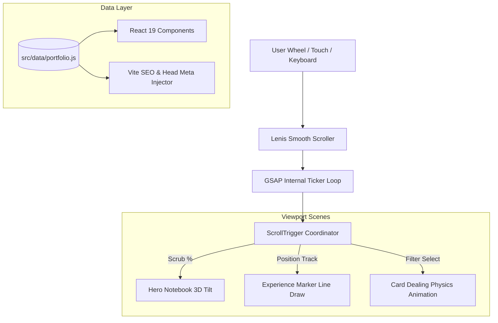

<div align="center">

# ✦ J E Y A J O T H I &nbsp; D ✦
### 🖋️ Hand-Drawn Full-Stack Portfolio & Motion Experience
**Crafted with React 19 • Vite • Tailwind CSS 4 • GSAP ScrollTrigger • Lenis**

<p align="center">
  <a href="https://jo-portfolio-two-neon.vercel.app" target="_blank">
    
  </a>
  <a href="https://github.com/jeyajothi08/jo-portfolio" target="_blank">
    
  </a>
  <a href="https://www.linkedin.com/in/jeyajothi-d-a99544299" target="_blank">
    
  </a>
</p>

<p align="center">
  
  
  
  
  
  
</p>

```
   ┌─────────────────────────────────────────────────────────────┐
   │  📂 JEYAJOTHI.JS                                            │
   │  ─────────────────────────────────────────────────────────  │
   │   role        : "Full Stack Developer"                      │
   │   location    : "Madurai, Tamil Nadu, India"                │
   │   education   : "B.E. Computer Science & Design"            │
   │   status      : "Available for Full Stack & AI Web Roles"   │
   │   specialty   : "Clean UI ✦ Fast APIs ✦ Creative Motion"     │
   └─────────────────────────────────────────────────────────────┘
```

---

<p align="center">
  <a href="#-interactive-showcase"><b>Explore Features</b></a> •
  <a href="#-architecture--motion-pipeline"><b>Architecture</b></a> •
  <a href="#-tech-stack--tooling"><b>Tech Stack</b></a> •
  <a href="#-featured-projects"><b>Projects</b></a> •
  <a href="#-quick-start"><b>Quick Start</b></a>
</p>

</div>

<br />

---

## 🎨 Interactive Showcase

<details open>
<summary><b>📐 1. Tactile Hand-Sketched Design System</b></summary>
<br>

Designed from the ground up to feel like authentic physical stationery rather than standard web components:
- **Ruled Paper & Index Cards:** Real mathematical SVG patterns generating blue notebook lines and red margin boundaries.
- **Wobbly Pencil Contours:** Hand-tuned irregular border-radius tokens (`rounded-wobbly`, `rounded-blob`) simulating authentic freehand pencil strokes.
- **Physical Shadows:** Zero-blur hard-offset drop shadows (`4px 4px 0 var(--ink)`) for an unmistakable pop-art elevation.
- **Stationery Accents:** Semi-transparent frosted adhesive tape (`.tape`), brass pushpins (`<Tack />`), and pastel yellow sticky notes (`<StickyNote />`).

```
  [ 📌 TACK ]
  ┌──────────────────────────────────────────────────┐ ╱|
  │  Sticky Note: Clean UI & Scalable APIs           │/ │ [ 🩹 TAPE ]
  │  ──────────────────────────────────────────────  │  │
  │  Drawn in felt-tip marker with irregular borders │ /
  └──────────────────────────────────────────────────┘'
```
</details>

<details open>
<summary><b>🎬 2. Cinema-Grade GSAP & Lenis Motion Pipeline</b></summary>
<br>

Motion is engineered with strict performance budgets and buttery smooth synchronization:
- **Unified Tick Loop:** Lenis momentum scrolling directly drives GSAP's internal ticker for artifact-free ScrollTrigger scrubbing.
- **Scroll-to-Zoom Stage:** Hero notebook and About section scale seamlessly into full viewport view as scroll depth advances.
- **Timeline Progression:** The Experience section features an animated red felt-tip marker path drawn dynamically down the margin while scrolling.
- **Interactive Card Dealing:** Project entries are dealt out onto the desk with physics-based spring rotation when filters switch.
</details>

<details open>
<summary><b>💾 3. Direct Local Resume Streamer</b></summary>
<br>

- Uses asynchronous Blob fetching (`window.URL.createObjectURL(blob)`) to guarantee direct local downloading rather than trapping users inside in-browser PDF viewers.
- Fallback anchor dispatch ensures instantaneous downloading across Safari, Chrome, Firefox, and mobile browsers.
</details>

<br />

---

## 🧬 Architecture & Motion Pipeline



<br />

---

## 🛠️ Tech Stack & Tooling

<div align="center">

| Core Framework | Styling & Theming | Motion Engine | Asset Pipeline |
| :---: | :---: | :---: | :---: |
|  |  |  |  |
| **React 19 Core**<br>Functional Components, Hooks | **Tailwind CSS v4**<br>Native CSS Variables, Zero-Runtime | **GSAP & ScrollTrigger**<br>Timeline Scrubbing & Pinning | **Vite Next-Gen Bundler**<br>Lightning Fast HMR & Build |

<br />

| Category | Technologies |
| :--- | :--- |
| **Frontend** | React 19, JavaScript (ESNext), Tailwind CSS 4, HTML5 Semantic Structure |
| **Motion & Audio** | GSAP 3, ScrollTrigger, Lenis Smooth Scroll |
| **Icons & Typography** | Lucide React, Google Fonts (`Kalam`, `Patrick Hand`) |
| **Backend & APIs** | Node.js, Express, Python, FastAPI, RESTful APIs |
| **Database & Cloud** | MongoDB, PostgreSQL, Firebase Firestore, MySQL, Redis |
| **AI / ML** | OpenAI GPT-4o API, Scikit-learn, Pandas, NumPy |
| **DevOps & Hosting** | Git, GitHub, Vercel, Netlify |

</div>

<br />

---

## 🚀 Featured Projects

<table>
  <tr>
    <td width="33%" valign="top">
      <h3 align="center">🤖 SalesPilot</h3>
      <p align="center"><b>AI Sales Automation & CRM</b></p>
      <p>An enterprise-grade CRM with automated workflows, background job workers, and GPT-4o integration for lead generation.</p>
      <p align="center">
        <code>React</code> <code>Vite</code> <code>FastAPI</code> <code>PostgreSQL</code> <code>Redis</code> <code>Celery</code> <code>OpenAI</code>
      </p>
      <p align="center">
        <a href="https://github.com/jeyajothi08/SalesPilot"><b>View Source Code ➜</b></a>
      </p>
    </td>
    <td width="33%" valign="top">
      <h3 align="center">🩺 Lung Cancer AI</h3>
      <p align="center"><b>Predictive Diagnostic ML</b></p>
      <p>Machine learning classification engine trained on patient biomarkers to predict early pulmonary oncology indicators.</p>
      <p align="center">
        <code>Python</code> <code>Scikit-learn</code> <code>Pandas</code> <code>NumPy</code>
      </p>
      <p align="center">
        <a href="https://github.com/jeyajothi08/lung-cancer"><b>View Source Code ➜</b></a>
      </p>
    </td>
    <td width="33%" valign="top">
      <h3 align="center">🌿 Plant Disease Detector</h3>
      <p align="center"><b>Computer Vision Web App</b></p>
      <p>Agricultural diagnostic application classifying leaf pathologies instantly from high-resolution user photo uploads.</p>
      <p align="center">
        <code>Python</code> <code>Flask</code> <code>Scikit-learn</code> <code>OpenCV</code>
      </p>
      <p align="center">
        <a href="#projects"><b>Interactive Preview ➜</b></a>
      </p>
    </td>
  </tr>
</table>

<br />

---

## ⚡ Quick Start

Clone and launch your local development server in seconds:

```bash
# 1. Clone the repository
git clone https://github.com/jeyajothi08/jo-portfolio.git

# 2. Enter the workspace
cd jo-portfolio

# 3. Install dependencies
npm install

# 4. Start local development server
npm run dev
```

Visit **`http://localhost:5173`** to interact with the live dev server with instantaneous hot-module replacement.

### 📦 Production Build & Testing

```bash
# Compile optimized bundle to dist/
npm run build

# Preview production build locally
npm run preview
```

<br />

---

## 📂 Repository Anatomy

```
jo-portfolio/
├── 📁 public/
│   ├── favicon.svg          # Custom hand-drawn JD emblem
│   ├── og-image.png         # OpenGraph social card (1200x630)
│   ├── profile.jpg          # Polaroid profile photograph
│   └── resume.pdf           # Offline curriculum vitae
├── 📁 src/
│   ├── 📁 components/       # Application views & section modules
│   │   ├── About.jsx        # Zoom-in stage & interactive polaroid
│   │   ├── Contact.jsx      # Formspree endpoint & email action
│   │   ├── Education.jsx    # Index-card academic history
│   │   ├── Experience.jsx   # Dynamic drawn timeline track
│   │   ├── Hero.jsx         # Felt-tip typography & notebook card
│   │   ├── Navbar.jsx       # Floating paper header & scroll gauge
│   │   ├── Projects.jsx     # Card-dealing gallery with category tabs
│   │   └── Skills.jsx       # Stack box diagrams & pinned sticky notes
│   ├── 📁 components/ui/    # Reusable sketch & doodle components
│   ├── 📁 data/
│   │   └── portfolio.js     # Single source of truth for all content
│   ├── 📁 lib/              # GSAP animations, Lenis scroller, downloaders
│   ├── index.css            # Hand-drawn design tokens & paper hatchings
│   ├── main.jsx             # React DOM root entry
│   └── App.jsx              # Application layout root
├── package.json
└── vite.config.js           # Headless SEO & build-time metadata plugin
```

<br />

---

## 📮 Get In Touch

<div align="center">

**Jeyajothi D** — Full Stack Developer  
*Madurai, Tamil Nadu, India*

[](https://www.linkedin.com/in/jeyajothi-d-a99544299)
[](https://github.com/jeyajothi08)
[](mailto:jeyajothi18082005@gmail.com)

<br />

<sub>Designed & Engineered by **Jeyajothi D** • Open Source</sub>

</div>
